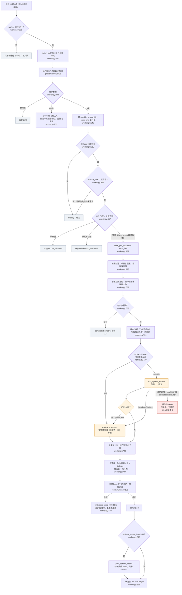
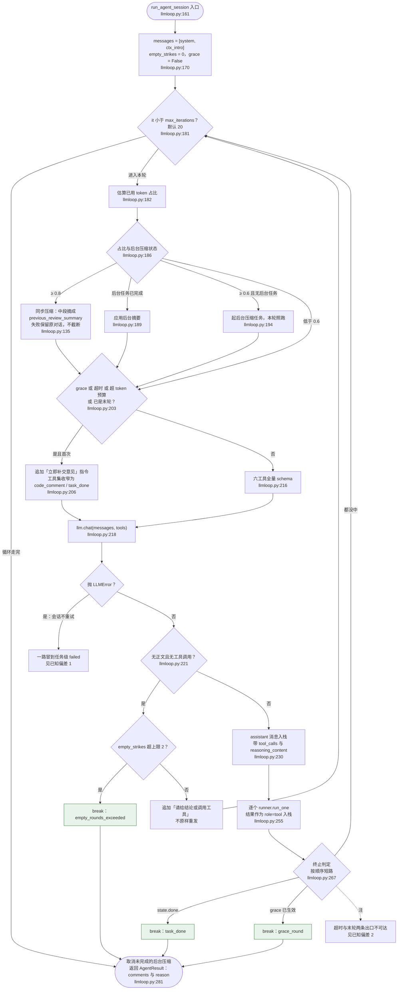
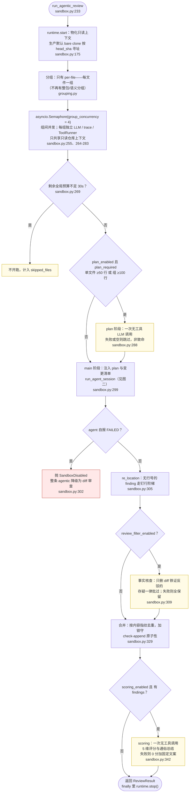

# Agent 工作流图

用 Mermaid 描述 agentic 审查的真实控制流，供排查与改动时对照。

**读图约定**：节点里的 `文件:行` 指向该步骤的实现位置（点开即达）；实线是正常流，
虚线是注释或异常出口；菱形是判断点，**菱形出来的每条边都对应代码里的一个真实分支**，
没有省略。

三张图各有分工：图一回答"一次 MR 从 webhook 到评论回写，中间会跳过或降级几次"，
图二回答"一个文件组内部的工具循环怎么跑、怎么收尾"，图三回答"组内四个阶段的失败
语义为何各不相同"。

图里也如实画出了三处**文档宣称与代码实际不一致**的地方，见文末
[已知偏差](#已知偏差文档宣称--代码实际)，读图时请一并看。

## 图一：MR 主链与分发

跳过的三种语义不同，图里用同一底色但原因各异：`hold`（无 worker，补上 worker 后可由
前端重试）、`already`（幂等，同 head 不重复审）、`skipped`（门控未开，改配置后可重试）；
`completed-empty` 是**正常终态**，不是失败。

## 图二：单文件组的 agent 会话循环

这是 agent 工作流的主体：一个组一个会话，最多 20 轮，每轮一次 LLM 调用 + 若干工具调用。

三个要点：

- **循环永远返回结果，不抛异常**（唯一例外是 LLM 传输错误，见偏差 1）。超预算、超时、
  空轮都是"收束并交出已有 comments"，不是异常。
- **grace 是收敛开关，不是失败标记**：一旦进入 grace，工具集只剩补交意见和结束两个，
  模型没有继续探索的余地。
- **压缩失败绝不丢证据**：三区结构保证 system + 首条 user 恒在，active 尾部完整保留，
  中段压缩失败就保留原样（宁可超 token 也不截半截对话）。

## 图三：一个文件组的四阶段与失败语义

四个阶段的失败语义刻意不同，这是刻意的设计而非疏漏：

| 阶段 | 失败时 | 为什么这样 |
| --- | --- | --- |
| plan | 跳过该阶段，直接进 main | 只是给模型的提纲，缺了不影响审查 |
| main | agent 自报 FAILED 则**整条降级** | 模型明确说"我审不了"，硬出结果不如退回 diff |
| re_location | 逐级降级，最后保留原片段 | 钉不上行号的意见会被折叠进摘要评论，不丢内容 |
| review_filter | 失败则**全部保留** | 它只删"被 diff 铁证反驳"的错评，存疑必须放过 |
| scoring | 0 分 + 固定文案 | 评分是展示层，不该影响审查结论 |

### 钉行阶梯（re_location.py:246-269）

`code_comment` 的 schema 故意不含 `line`：模型只粘 `existing_code`，行号全由引擎按
字符串匹配钉出。三步阶梯，逐级降级：

1. **同文件确定性匹配**（`relocation.py:128-181`）：按 hunk 做连续行归一化匹配，
   先新侧后旧侧；再退到全量新文件内容扫描。
2. **跨文件唯一匹配**（`relocation.py:184-206`）：片段在所有 diff 的新侧内容里
   必须**恰好命中一次**，零次或多次都拒绝（多次意味着歧义，宁可不钉）。
3. **LLM 重定位**（`relocation.py:217-243`，`relocation_enabled` 控制）：把 diff 与
   原片段给模型，取围栏代码块作为新片段再回第 1 步匹配；仍失败则还原原片段。

三步都没钉上的 finding 不会丢：`ResultWriter.partition_findings` 按
`commentable_lines` 把它折进摘要评论（`result_writer.py:25-47`）。

## 六个工具（tools.py:419-451）

agent 只能碰这六个，没有 shell，也不写工作区：

| 工具 | 作用 | 硬约束 |
| --- | --- | --- |
| `grep_repo` | 全仓文本搜索 | 命中超 100 条截断 |
| `read_file` | 读文件行区间 | 单次 ≤500 行 |
| `file_find` | 按文件名找路径 | ≤100 条 |
| `file_read_diff` | 取已解析的 diff 文本 | 仅限已解析路径 |
| `code_comment` | **唯一**的意见上报渠道 | 必带 `existing_code`；schema 不含 `line` |
| `task_done` | 结束会话 | DONE 正常收尾；FAILED 触发整条降级 |

在有 `repo_dir` + `pinned_sha` 的运行时下（生产默认的 `LocalCloneRuntime`），三个读文件
工具一律走 `git cat-file` / `git grep` / `ls-tree` 按**不可变对象**寻址
（`tools.py:39-139`），因此跨 PR 并发、force-push 都不会把读到的内容换掉，也就
不需要容器隔离。工具层的错误（未知工具、参数非法、越权路径）都返回错误 JSON 串让模型
自己看见，不中断整轮（`tools.py:468-478`）。

## 三条设计不变量

1. **行号不由模型负责**：模型报行号会错，所以干脆不收。只收代码片段，行号由钉行阶梯
   纯字符串匹配产出。
2. **成果先落库、后回写**：findings 在回写之前入库（`worker.py:744-771`）。回写失败
   只打 `writeback_failed` 标记 + IM 提示，前端"重新发送"走 `redeliver` 复用已存结果，
   **不重算**昂贵审查（`worker.py:783-809`、`result_writer.py:239-259`）。
3. **预算耗尽也要出结论**：`grace` 终轮逼模型交出已有意见，而不是抛异常重跑
   （`llmloop.py:199-216`，对应 antipattern B8）。

## 已知偏差：文档宣称 ≠ 代码实际

以下三处是读代码时核对出来的，图里已按**代码实际行为**画。它们是排查时最容易误判的地方。

### 偏差 1：只有 `SandboxDisabled` 会降级为 diff 审查

- **宣称**：README「工作方式」说"agent 探一圈仓库，出任何岔子整条退回 diff，绝不把
  agent 的失败记成任务失败"；`worker.py:196-198`、`sandbox.py:8-9`、
  `llm_adapter.py:5` 都重申这一点。
- **实际**：`_review_agent_or_diff` 只 `except SandboxDisabled`（`worker.py:222-223`）。
  真正会降级的只有五种情形：运行时 guard 失败（docker 默认关、agentic 未启用、
  无 git）、clone 型运行时的 `pr is None`、分组异常、agent 自报 FAILED，以及**产出 0 条**
  （这条走的是 `worker.py:209-220`，不是异常路径）。
- **漏网的两类异常都是瞬时问题**：
  - `RepoCloner` 抛裸 `RuntimeError`（`syncer.py:79-85`，以及 `syncer.py:289` 的
    "目标 commit 在 fetch 后仍不可达"），而 `runtime.start` 在 `try` 之外
    （`sandbox.py:249`）——私有仓库缺 token、网络抖动、head_sha 尚未同步都会走这里。
  - `LLMError`：会话循环对单轮失败不重试（`llmloop.py:218`），adapter 把网络/超时/鉴权
    一律归一为 `LLMError`（`llm_adapter.py:107-114`），一路冒到 `_do_review_pull_request`
    的兜底（`worker.py:845-853`）标 `failed` 再抛给队列。
- **实际影响**：这两类恰恰最该降级——diff 审查只需要平台 API，不依赖 clone 和长会话。
  现在的结果是一次网络抖动就把整次审查变成 failed，用户看到的是"审查失败"而非"降级结果"。

### 偏差 2：`time_exceeded` / `max_iterations` 两条终止出口不可达

- `llmloop.py:203-205` 在 `over_time`、`over_budget`、末轮任一命中时，同一轮里就把
  `grace` 置为 `True`（`llmloop.py:213`）；随后 `llmloop.py:270-273` 的 `if grace`
  先于 `over_time`（`:274`）和末轮判断（`:277`）命中。
- 所以 `reason` 的取值实际只有三种：`task_done`、`grace_round`、`empty_rounds_exceeded`。
  `llmloop.py:274-279` 的两条分支是死代码，`llmloop.py:291-292` 那句"reason 常见
  max_iterations / grace_round"也不成立。
- **实际影响**：观测上分不出"超时收尾"与"迭代耗尽收尾"。刚加的 `run_budget_seconds`
  诊断（`sandbox.py:269-273`）正好依赖这个区分，建议在进 grace 前把触发原因存进
  `reason` 再进终轮。

### 偏差 3：后台压缩失败会把瞬时故障升级为任务失败

- 同步压缩有 try 兜底（`llmloop.py:151-155`，"压缩失败绝不丢证据"）；但后台路径
  `_compress_to_text` 没有（`llmloop.py:300-307`），而 `summarize` 会把传输异常归一为
  `LLMError`（`llm_adapter.py:157-174`）。
- 下一轮 `pending_compress.result()` 没有接异常（`llmloop.py:189-193`），异常就此抛出，
  按偏差 1 的路径变成任务级 failed。
- **实际影响**：压缩只是省 token 的旁路，其失败按设计应当无感（保留原对话继续）。
  现在一次瞬时 summarize 失败即可弄挂整次审查。

## 维护提示

改这几处时请同步更新对应的图，否则文档会静默过时：

| 改动位置 | 要更新的图 |
| --- | --- |
| `llmloop.py` 的压缩阶梯、grace 触发、终止判定 | 图二 |
| `sandbox.py` 的阶段顺序、并发、预算检查 | 图三 |
| `worker.py` 的门控、过滤、分发、回写顺序 | 图一 |
| `_review_agent_or_diff` 的异常捕获范围 | 图一 + 偏差 1 |
