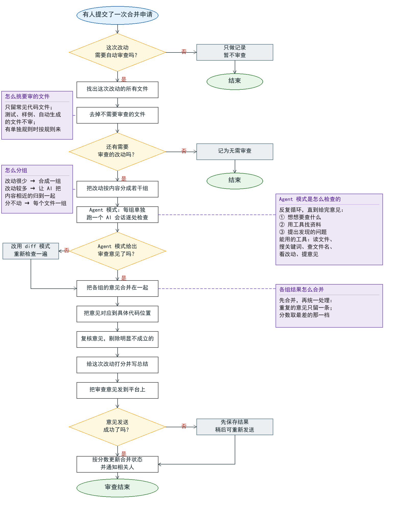
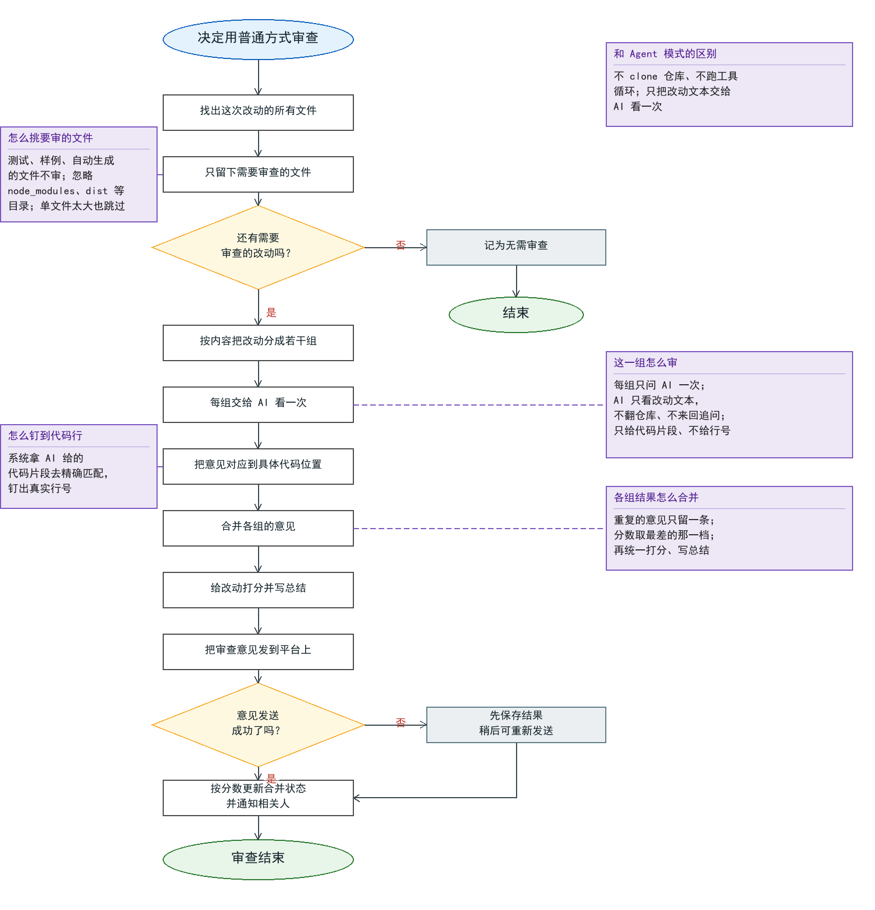
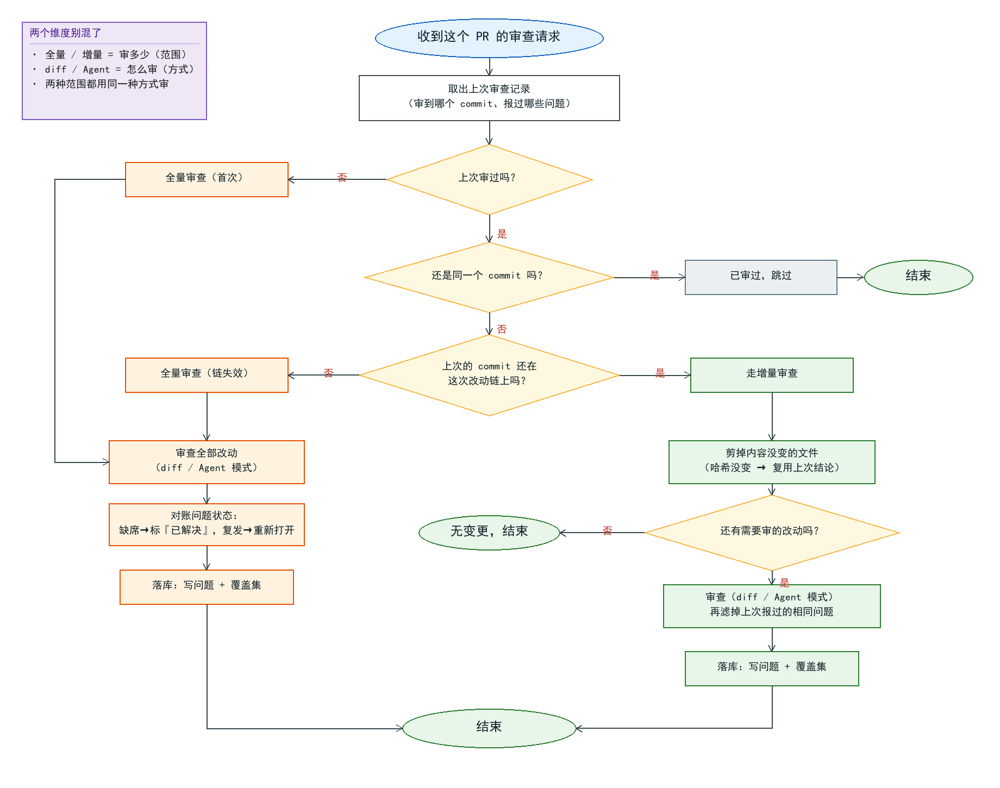
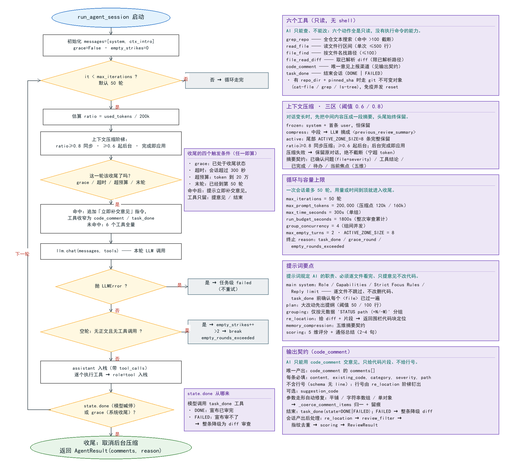

# 智能审查流程

这张图描述一次代码合并申请从提交到审查完成的完整过程，从上到下、沿箭头依次阅读。

形状说明：
- 椭圆：开始或结束
- 矩形：一个步骤
- 菱形：一个判断，分出「是」和「否」两条路

### 详细说明

**怎么挑要审的文件（测试/样例/自动生成具体指什么）**

判断只看**文件路径和扩展名**，不看内容：

- **扩展名白名单**：常见代码/配置/模板文件（`.py`、`.js`、`.ts`、`.go`、`.java`、`.rs`、`.vue`、
  `.sql`、`.yaml`…）才审；**没有扩展名**的文件（如 `Makefile`、`Dockerfile`）一律放行。
- **路径排除**（命中任一条就跳过）：
  - 算**测试**：名字或目录里带 `_test`、`.test.`、`.spec.`、`Test`、`Tests`，或位于 `test/`、
    `tests/`、`__tests__/`、`spec/`、`src/test/` 下。
  - 算**快照/样例**：`__snapshots__/`、`*.snap`、`testdata/`、`fixtures/`。
  - 算**自动生成**：`*.generated.*`、`*.gen.go`、`*.pb.go`、`*_capnp.*`、`kitex_gen/`、
    `vendor/**/*.jsonnet` 等。
- 匹配用通配：`**` 跨目录、`*` 单个目录段、`{a,b}` 二选一，且大小写不敏感。
- 只有项目**没有**另配 `file_extensions` 时才用这套默认范围；配了自定义范围就只按项目配置。

**怎么分组：什么叫多、什么叫少、什么叫分不动**

分组看的是**这次改动了多少**（文件个数 + 改动行数），**不是整个文件多大**，也不看整文件内容：

- **1 个文件**：不用分，一个文件一组。
- **2～3 个文件**：改动**少**（新增 + 删除 < 200 行）→ 合成一组；改动**多**（≥ 200 行）→ 每个文件一组。
- **≥ 4 个文件**：交给 AI 按「内容相关性」分组（只看文件名和改动行数，不看具体代码）。
- **「分不动」** = AI 分组失败或返回空（重试一次后仍不行）→ 退化成每个文件一组。
- **兜底两条**：一组超过 10 个文件就切开；某组内 diff 累计的 token 超过约 16 万（= 0.8 × 20 万）
  就把整组拆成每文件一组。
- 单个文件的 diff **自身**就超过约 16 万 token 的，直接跳过不审（防一个大文件顶爆上下文）。

**Agent 模式没给出意见时会怎样（改用 diff 模式）**

如果 Agent 模式走完工具循环**一条意见都没产出**，就改用 **diff 模式**：不 clone 仓库、不跑工具循环，
直接把每个改动的 diff 文本喂给模型，让它基于改动本身给出意见与打分。沙箱不可用（比如没有 git、
agentic 未开启）时走的也是这条兜底，保证至少有一条审查落回。

**复核意见具体怎么做**

会话产出后由模型做一次「事实核查」：把它发现的问题和本组的 diff 放在一起再给模型，只删**被 diff
明确反驳**的评论（例如评论说「这里少判空」，但 diff 里其实有判空）。它必须二选一给结论——点名要
删的编号，或者「全部保留」；凡是拿不准的、模型没说清的、调用失败的，一律保留。它只删错评、不会
凭空补充新意见。多组结果合并时还会按内容指纹再去一次重。

## 普通 diff 审查（diff 模式）

这张图是「diff 模式」的流程：不翻仓库、不跑工具循环，只把每个文件这次的改动交给 AI 看一遍。
它是 Agent 模式失败或没给出意见时的兜底，也是不少项目的默认方式。

### 详细说明

**和 Agent 模式的区别**

diff 模式不 clone 仓库、没有工具循环，AI 只能看到「这次改动的文本」，不能自己去翻其它文件。
所以它更快、更省，但看不到改动之外的上下文；每组只问 AI 一次，不做多轮追问。

**这一组怎么审**

每个文件组单独调用一次模型：把该组 diff 拼成提示词（外加固定的评分规则、严重级别、定位要求、
安全要求等），要求模型**严格输出 JSON**；输出里同样没有行号，只给 `existing_code` 代码片段。

**怎么钉到代码行**

系统拿 AI 给的代码片段，去这组改动里做字符串精确匹配，钉出真实行号；匹配不到的意见会被折进
总结评论，不会丢。

**各组结果怎么合并**

各组并发跑完后合并：重复的意见只留一条（按「文件 + 正文」指纹去重）；5 个维度的分数取所有组里
**最差的那一档**（不因分组而稀释严重度）；总结按组拼接；被过滤的文件取并集。另外，如果开了静态
分析，它的结果会被直接并入（不参与去重）。

**怎么挑要审的文件 / 发送失败怎么办**

筛选规则与主流程一致：测试、样例、自动生成的文件不审，`node_modules`、`dist` 等目录忽略，单个
文件太大也跳过；意见发送失败时先保存结果、之后可重新发送，不重算。

## 增量审查机制（MR / PR 轨）

推送新提交时，系统不会每次重审整个 PR，而是先判断「这次能不能安全地只审增量」。下图是判断与
两条路径的流程。（push 轨没有这套机制。）

先澄清两个容易混淆的维度：「**全量 / 增量**」指的是**审多少**（审查范围）；「**diff / Agent**」
指的是**怎么审**（审查方式）。两者相互独立——**全量审查也会用当前项目配置的 diff 或 Agent 方式**，
只是范围覆盖全部改动而已。

### 详细说明

**第一步：取上次审查记录**

取该 PR 最近一次 `completed` 的审查任务的落点：它审到的 `head_sha`，以及它报过的所有问题指纹
（`review_finding.fingerprint`）。这是后面所有判断的依据。

**第二步：决定走哪条路**

- 没有记录 → **首次审查**，全量。
- 记录里的 commit 和这次的 commit 相同 → 同一个提交被重复触发，**直接跳过**（`already`）。
- 不同、且上次的 commit **仍在这次改动的链上**（是追加提交，平台的 compare 校验通过）→ 走
  **增量审查**。
- 不同、且链失效（force-push / rebase / 合主干改写了历史）→ **回退全量审查**（宁可多审一遍，
  也不在失效链上误判「问题已解决」）。

**增量路径做了什么**

1. **剪掉没变的文件**：把每个文件新侧内容的哈希和上次存下的覆盖集比对，哈希没变的文件直接复用
   上次「已审过干净」的结论，不再喂给模型（省 token 与时间）。剪完若再无改动 → 记为「无变更」结束。
2. **审查**：对剩下的改动走 diff 或 Agent 模式。
3. **滤掉重复问题**：按**内容指纹**（`文件 + 正文`，**不看行号**——行号会随提交漂移，内容不会）
   把上次已报过的问题去掉，避免重复贴评论。

**全量路径做了什么**

1. 重审**全部的改动**（用当前项目配置的 **diff 或 Agent** 方式，与增量路径是同一种「方式」，
   区别只在「范围」覆盖全部文件）。
2. **问题状态对账**：和这个 PR 以往已报的问题逐条比对——本轮缺席的（且所在文件本轮被覆盖到）
   标为「已解决」；之前已解决、这轮又出现的，重新打开并累加复发次数。注意：**本轮没覆盖到的
   文件上，缺席一律不算「已解决」**（保守门，防止部分审查造成误判）。
3. 落库：写问题、并把本轮覆盖集 `{文件: 内容哈希}` 存下来，供下一轮复用与「未审」判定。

**一句话**：用 commit 判断能不能安全地只审增量，用**内容哈希**判断文件有没有变过，用**内容指纹**
判断问题是不是重复，用**状态机**记录问题「出现 → 修复 → 复发」的一生。

**内容哈希 vs 内容指纹（两个别混）**

两者都是 SHA1，但算的对象和用途不同：

| | 内容哈希 | 内容指纹 |
| --- | --- | --- |
| 算什么 | 一个文件**改动后的整份新内容** | 一条**审查意见**的「文件 + 正文」 |
| 算法 | `sha1(新文件全文)` | `sha1(文件 : 正文.strip().lower())` |
| 存哪 | 任务的 `diff_snapshot`（覆盖集 `{文件: 哈希}`） | `review_finding.fingerprint`（每条意见一行） |
| 用来 | 判断**文件有没有变** → 没变就复用上次结论、不重审 | 判断**问题是不是同一个** → 去重、状态对账 |
| 含行号吗 | 不含（算的是文件内容） | 不含（同一问题挪了行号仍算同一条） |

- **内容哈希**：算的是整个新文件（不是 diff 片段）；纯删除的文件没有新内容，返回空、一律保留不剪。
- **内容指纹**：算的是意见正文（不是位置）；同一问题从第 10 行挪到第 50 行，指纹不变，仍算同一条。
- 另注：代码里还有几种同名但口径不同的指纹，别混淆——Agent 模式内部跨组去重用「正文/代码片段
  归一化」指纹，回写幂等用 `provider/repo/pr/head` 组合指纹。

## Agent 内部运行机制

这张图从技术角度说明 Agent 在后台是怎么跑起来的：循环流程、可用工具、上下文压缩、
提示词要点、输出契约，以及容量与次数上限。

### 详细说明

**AI 是怎么一圈圈检查的（循环）**

AI 不是一次把整份改动看完，而是「想一步、做一步」地反复循环：每一轮它先想一想这轮要查什么，
再用工具去仓库里翻资料，然后把自己发现的问题交上来；只要还没结束、次数或用量还没到顶，就进入
下一轮。跑到次数上限、时间或用量超了，就会进入「收尾」（图里的 grace）：这一轮不许再到处探索，
只能把已经发现的问题交出来、然后结束。每一轮最多调用模型一次，最多循环 50 轮。

**什么时候才收尾：grace 与 state.done**

收尾有两条来源，一个被动、一个主动：

- **系统被动收尾（grace）**：每轮开头检查四个条件，任一命中就进入收尾模式——① 已经处于收尾
  状态（一旦进入就不回退）；② 这个文件组的会话超过 300 秒；③ 本轮 token 到 20 万上限；④ 已经
  跑到第 50 轮（末轮）。首次命中时会追加一句「立即补交意见」，并把工具收窄到只剩
  `code_comment`／`task_done`，逼 AI 交出结论而不是继续探索。
- **AI 主动喊停（state.done）**：当 AI 调用 `task_done` 工具时置上——`DONE` 表示「审完了」，
  `FAILED` 表示「审不了」（后者会让整条退回普通审查）。

一轮结束时先看 `state.done`：命中就正常结束（原因记为 `task_done`）；否则若处于 grace，就按
「到顶收尾」结束（原因记为 `grace_round`）。

**AI 能用的六个工具**

AI 手上只有六个只读动作，没有执行命令、修改代码的能力：

- `grep_repo`：在整份代码里搜关键词（命中太多就截断到 100 条）。
- `read_file`：读某个文件的某几行（一次最多 500 行）。
- `file_find`：按文件名找路径（最多 100 条）。
- `file_read_diff`：看某个文件这次的改动内容。
- `code_comment`：把它发现的问题交上来——这是唯一能「产出意见」的工具。
- `task_done`：宣告这次检查结束（正常结束或失败退出）。

查文件时它读的是仓库里「固定的历史版本」，所以就算别人同时在改、强推代码，也不会把 AI 正在看的
内容换掉。

**对话太长时怎么压缩（上下文压缩）**

一轮轮下来，对话会越来越长、占用的上下文（相当于 AI 的「临时记忆」）越来越多。做法是把对话分成
三段：开头（系统设定 + 任务说明）始终保留；结尾最近 8 条完整保留；中间那一段交给模型压缩成一段
简短摘要。用量到 80% 就当场压缩，到 60% 就提前在后台悄悄压。压缩失败不影响审查——宁可让它多占点
空间，也绝不把对话截成半截、丢掉已经查到的证据。

**次数和容量的上限**

一次会话最多 50 轮；上下文最多 20 万 token（约到 12 万就开始后台压缩、16 万就同步压缩）；单个文件
组最多跑 5 分钟；整次审查所有组累计最多 30 分钟；同一时刻最多 4 个组并行。收尾时会记下结束原因
（正常结束 / 到顶收尾 / 连续空转）。

**提示词里的几条硬规矩**

给 AI 的系统提示词规定了：它的角色和能力、必须「逐个文件都过一遍」不能漏、只能提意见不能改代码、
说结束之前要确认每个文件都看过了。此外还有几个专项提示词：大改动先出一份提纲；分组时只看文件名
和改动行数、不看具体内容；定位时让它从改动里挑出对应的代码片段；压缩时按五个要点写摘要；最后给
这次改动打 5 个维度的分并写一段大白话总结。

**它怎么把意见交出来**

AI 唯一的产出通道是 `code_comment`，一次可以交多条，每条要写清楚：问题描述、对应的代码片段、
问题类别、严重程度、所在文件。它**不用也不该给行号**——行号由系统拿它给的代码片段去精确匹配出来，
这样更准。如果 AI 把参数写得不规范（比如字段散落在外面、数组写成了字符串），系统会尽量自动修正并
记录下来。全部会话结束后，系统还会做一串收尾：把意见定位到具体代码行、剔除明显站不住脚的、去掉
重复的、给整体打分，最后才汇总成审查结果。
